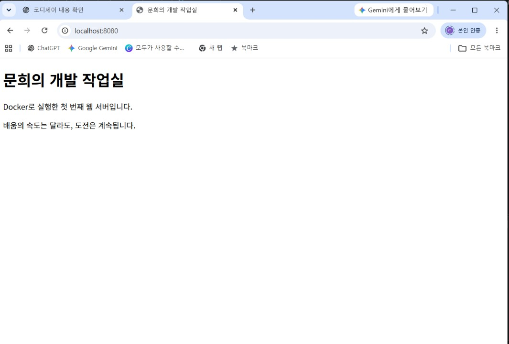

# 내 컴퓨터에 개발자용 작업실 꾸미기

## 1. 프로젝트 개요
리눅스 터미널, Docker, Git/GitHub를 활용하여 재현 가능한 개발 환경을 구축한다.
수행한 명령과 실제 결과를 기록하고, 오류의 원인과 해결 과정을 정리한다.

## 2. 실행 환경
- 호스트 OS: Windows 11 Home (버전 10.0.26200, 빌드 26200)
- 리눅스 환경: WSL 2 Ubuntu 26.04.1 LTS
- 터미널: VS Code 통합 터미널
- 실습 경로: /home/kimmoonhee/codyssey/practice
- Docker Client/Server: 29.9.2
- Git 버전: 2.53.0

## 3. 수행 체크리스트
- [x] 터미널 기본 조작
- [x] 파일 및 디렉토리 권한 변경
- [x] Docker 버전 및 엔진 연결 확인
- [x] hello-world 실행 결과 기록
- [x] Ubuntu 컨테이너 실행 및 내부 명령 실습
- [x] 이미지·컨테이너 운영 명령 실습
- [x] Dockerfile 작성 및 커스텀 이미지 빌드
- [x] 포트 매핑 및 브라우저 접속 증거
- [x] 바인드 마운트 변경 반영 검증
- [x] 볼륨 데이터 영속성 검증
- [x] Git 설정 및 GitHub·VS Code 연동

## 4. 터미널 기본 조작

아래는 실제 실행한 명령과 출력의 발췌이다.
출력이 없는 명령은 다음 확인 명령으로 결과를 검증했다.

### 실습 폴더 생성 및 이동
```bash
mkdir -p ~/codyssey/practice
cd ~/codyssey/practice
pwd
```
출력:
```text
/home/kimmoonhee/codyssey/practice
```

### 빈 파일 생성 및 내용 확인
```bash
touch memo.txt
ls -l memo.txt
echo "Hello, Codyssey!" > memo.txt
cat memo.txt
```
출력:
```text
-rw-r--r-- 1 kimmoonhee kimmoonhee 0 Nov 8 22:24 memo.txt
Hello, Codyssey!
```

### 복사·이름 변경·삭제
```bash
cp memo.txt memo-copy.txt
ls
mv memo-copy.txt memo-backup.txt
ls
rm memo-backup.txt
ls
cat memo.txt
```
출력:
```text
memo-copy.txt  memo.txt
memo-backup.txt  memo.txt
memo.txt
Hello, Codyssey!
```

### 숨김 항목을 포함한 목록 확인
```bash
ls -la
```
README 생성 전 확인한 항목:
```text
.
..
memo.txt
permission-test
```

## 5. 권한 변경 실습

### 파일: 644 → 600 → 644
```bash
ls -l memo.txt
chmod 600 memo.txt
ls -l memo.txt
chmod 644 memo.txt
ls -l memo.txt
```
출력:
```text
-rw-r--r-- 1 kimmoonhee kimmoonhee 17 Nov 8 22:24 memo.txt
-rw------- 1 kimmoonhee kimmoonhee 17 Nov 8 22:24 memo.txt
-rw-r--r-- 1 kimmoonhee kimmoonhee 17 Nov 8 22:24 memo.txt
```

### 폴더 권한 변경

실행 명령:
```bash
mkdir permission-test
ls -ld permission-test
chmod 700 permission-test
ls -ld permission-test
chmod 755 permission-test
ls -ld permission-test
```

실제 출력:
```text
drwxr-xr-x 2 kimmoonhee kimmoonhee 4096 Nov 8 22:31 permission-test
drwx------ 2 kimmoonhee kimmoonhee 4096 Nov 8 22:31 permission-test
drwxr-xr-x 2 kimmoonhee kimmoonhee 4096 Nov 8 22:31 permission-test
```

결과 해석:
- 폴더 권한을 755 → 700 → 755로 변경했다.
- 700은 소유자만 읽기·쓰기·접근할 수 있다.
- 755는 소유자에게 모든 권한을, 그룹과 그 외 사용자에게 읽기·접근 권한을 준다.
- 폴더의 x는 내부 항목에 접근하고 경로를 통과하는 권한이다.

## 6. Docker 버전 및 엔진 연결 확인

실행 명령:
```bash
docker --version
docker info
```

실제 출력 발췌:
```text
Docker version 29.9.2, build a82e528

Server:
 Containers: 3
  Running: 0
  Paused: 0
  Stopped: 3
 Images: 2
 Server Version: 29.9.2
 Operating System: Docker Desktop
 OSType: linux
 Architecture: x86_64
```

검증 결과:
- Docker 클라이언트와 서버 버전은 29.9.2이다.
- Ubuntu 터미널에서 sudo 없이 Docker 엔진에 연결했다.
- 조회 당시 컨테이너 3개는 모두 정지 상태였다.

## 7. 트러블슈팅

### 사례 1. Ubuntu의 Docker 연동 미설정
- 문제: docker info에서 WSL integration을 활성화하라는 오류가 발생했다.
- 원인 가설: Ubuntu와 Docker Desktop의 연동이 꺼져 있을 가능성.
- 확인: Docker Desktop의 WSL integration 화면에서 Ubuntu가 미선택 상태였다.
- 조치: Ubuntu를 선택하고 Apply를 눌렀다.
- 결과: Linux Docker CLI가 사용됐고, 다음으로 소켓 권한 오류가 나타났다. 권한 문제는 사례 2에서 해결했다.

## 8. hello-world 컨테이너 실행

실행 명령:
```bash
docker run hello-world
```

실제 출력 발췌:
```text
Hello from Docker!
This message shows that your installation appears to be working correctly.
```

검증 결과:
Docker 엔진이 컨테이너를 생성하고 실행하여 메시지를 출력했다.
hello-world는 메시지를 출력한 후 종료되는 테스트 프로그램이다.

## 9. Ubuntu 컨테이너 내부 명령 및 종료 확인

컨테이너 생성·접속:
```bash
docker run -it --name codyssey-ubuntu-practice ubuntu bash
```

결과:
ubuntu:latest 이미지를 다운로드한 뒤 root 사용자로 컨테이너에 접속했다.

컨테이너 내부에서 실행:
```bash
pwd
ls
echo "Hello from my Ubuntu container!"
```

실제 출력:
```text
/
bin  boot  dev  etc  home  lib  lib64  media  mnt  opt  proc  root  run  sbin  srv  sys  tmp  usr  var
Hello from my Ubuntu container!
```

컨테이너 내부에서 종료:
```bash
exit
```

WSL Ubuntu로 돌아온 후 상태 확인:
```bash
docker ps -a --filter name=codyssey-ubuntu-practice
```

실제 출력의 주요 항목:
```text
CONTAINER ID: 2bac8a0415ee
IMAGE: ubuntu
COMMAND: "bash"
STATUS: Exited (0) 13 seconds ago
NAMES: codyssey-ubuntu-practice
```

관찰:
Bash를 주 프로그램으로 실행했으므로 exit로 Bash를 종료하자 컨테이너도 정지했다.
Exited (0)은 정상 종료를 의미하며, 컨테이너가 삭제된 것은 아니다.

## 10. 백그라운드 실행과 exec 종료 비교

실행 명령:
```bash
docker run -d --name codyssey-ubuntu-keep ubuntu sleep infinity
docker exec -it codyssey-ubuntu-keep bash
```

추가로 열린 Bash 안에서 실행:
```bash
echo "Inside exec shell"
exit
```

실제 출력:
```text
Inside exec shell
exit
```

WSL Ubuntu에서 실행 상태 확인:
```bash
docker ps --filter name=codyssey-ubuntu-keep
```

실제 출력의 주요 항목:
```text
CONTAINER ID: ba34000f9f26
IMAGE: ubuntu
COMMAND: "sleep infinity"
STATUS: Up 59 seconds
NAMES: codyssey-ubuntu-keep
```

관찰:
exec로 추가 실행한 Bash를 exit로 종료해도 주 프로그램인
sleep infinity는 계속 실행되므로 컨테이너가 유지됐다.
앞선 ubuntu bash 실습에서는 주 프로그램을 종료했기 때문에 컨테이너가 정지했다.

## 11. Docker 기본 운영 명령

### 이미지 목록
```bash
docker images
```
실제 출력의 이미지 목록:
```text
hello-world:latest
ubuntu:24.04
ubuntu:latest
```

### 로그 확인
```bash
docker logs codyssey-ubuntu-keep
```
출력 없음. 주 프로그램인 sleep infinity는 로그를 출력하지 않는다.

### 자원 사용량 확인
```bash
docker stats --no-stream codyssey-ubuntu-keep
```
실제 출력 발췌:
```text
NAME: codyssey-ubuntu-keep
CPU %: 0.00%
MEM USAGE / LIMIT: 6.449MiB / 7.357GiB
MEM %: 0.09%
PIDS: 1
```

### 컨테이너 중지 및 확인
```bash
docker stop codyssey-ubuntu-keep
docker ps -a --filter name=codyssey-ubuntu-keep
```
실제 출력 발췌:
```text
docker stop 출력: codyssey-ubuntu-keep
STATUS: Exited (137) 20 seconds ago
```

관찰:
컨테이너가 정지한 것을 확인했다.
종료 코드 137은 SIGKILL에 의한 종료를 나타낸다.
stop 대기 시간 후 강제 종료됐을 가능성이 있으나 정확한 원인은 검증 필요하다.

## 12. 커스텀 웹 서버 이미지 및 포트 매핑

### 베이스 이미지와 변경 목적
- 베이스: nginx:alpine
- LABEL: 이미지 제목을 moonhee-workspace로 지정했다.
- COPY: NGINX 기본 페이지 대신 직접 만든 site/index.html을 넣었다.
- EXPOSE 80: 컨테이너의 웹 서버 포트를 문서화했다.

### Dockerfile
```dockerfile
FROM nginx:alpine
LABEL org.opencontainers.image.title="moonhee-workspace"
COPY site/ /usr/share/nginx/html/
EXPOSE 80
```

### 이미지 빌드
```bash
docker build -t moonhee-web:1.0 .
```
실제 출력 발췌:
```text
[+] Building 10.1s (7/7) FINISHED
naming to docker.io/library/moonhee-web:1.0
```

### 컨테이너 실행
```bash
docker run -d --name moonhee-web-8080 -p 127.0.0.1:8080:80 moonhee-web:1.0
```
실제 출력:
```text
994319e089c2d0fa86a2b618416a7c62bf43547c75556c39edde4a12061b6585
```

### 브라우저 접속 확인
접속 주소: http://localhost:8080

직접 확인한 페이지:
- 문희의 개발 작업실
- Docker로 실행한 첫 번째 웹 서버입니다.
- 배움의 속도는 달라도, 도전은 계속됩니다.

호스트의 8080번 포트를 컨테이너의 80번 포트에 연결했다.
127.0.0.1에 바인딩하여 호스트 컴퓨터에서 접속하도록 설정했다.

브라우저 주소창과 페이지가 함께 보이는 캡처를 확보했다.


### 포트 매핑 브라우저 접속 증거
주소창의 localhost:8080과 직접 만든 웹 페이지를 함께 확인했다.



## 13. 바인드 마운트 변경 반영 검증

### 실행 명령
```bash
docker run -d --name moonhee-web-bind -p 127.0.0.1:8081:80 --mount type=bind,source="$(pwd)/site",target=/usr/share/nginx/html,readonly moonhee-web:1.0
```

실제 출력:
```text
35aeb890dccd0d77223e7897b944018c57a9efdc1f95108a5e6346b290d58d3c
```

호스트의 site 폴더를 컨테이너의 웹 문서 폴더에 연결했다.
readonly는 컨테이너에서의 쓰기를 막으며, 호스트에서는 수정할 수 있다.

### 호스트 파일 변경
```bash
sed -i 's/배움의 속도는 달라도, 도전은 계속됩니다./바인드 마운트로 수정 내용이 바로 반영됐어요!/' site/index.html
cat site/index.html
```

### 브라우저에서 변경 전후 확인
접속 주소: http://localhost:8081

- 변경 전: 배움의 속도는 달라도, 도전은 계속됩니다.
- 변경 후: 바인드 마운트로 수정 내용이 바로 반영됐어요!

이미지를 다시 빌드하거나 컨테이너를 재실행하지 않고,
호스트 파일 수정 후 브라우저 새로고침으로 변경을 확인했다.

## 14. Docker 볼륨 데이터 영속성 검증

### 볼륨 생성 및 첫 컨테이너 연결
```bash
docker volume create moonhee-data
docker run -d --name moonhee-volume-1 --mount source=moonhee-data,target=/data ubuntu sleep infinity
```

실제 출력:
```text
moonhee-data
168ed0dfdcf9d12effef66157303a78ef1ebad1422b9d54448c0efa1417878f3
```

### 데이터 저장 및 삭제 전 확인
```bash
docker exec moonhee-volume-1 bash -c 'echo "My data survives container deletion" > /data/memo.txt; cat /data/memo.txt'
```

실제 출력:
```text
My data survives container deletion
```

### 첫 컨테이너 삭제
```bash
docker rm -f moonhee-volume-1
```

실제 출력:
```text
moonhee-volume-1
```

### 새 컨테이너에 같은 볼륨 연결
```bash
docker run -d --name moonhee-volume-2 --mount source=moonhee-data,target=/data ubuntu sleep infinity
docker exec moonhee-volume-2 cat /data/memo.txt
```

실제 출력:
```text
9b0078082d0f5986ea24043bfe938063139f64095173f05597408562d5c7ed8c
My data survives container deletion
```

검증 결과:
첫 컨테이너를 삭제한 뒤 새 컨테이너에 같은 볼륨을 연결해
기존 파일을 읽었다. 데이터가 컨테이너와 별도로 유지됨을 확인했다.
볼륨 자체를 삭제하면 이 데이터도 삭제될 수 있다.

## 15. 트러블슈팅 보완 — 사례 2: Docker 소켓 권한 오류

### 문제
Ubuntu에서 다음 명령을 실행했으나 접근 권한 오류가 발생했다.
```bash
docker info
```
실제 오류:
```text
permission denied while trying to connect to the docker API at unix:///var/run/docker.sock
```

### 원인 가설 및 확인
사용자가 Docker 소켓에 접근할 그룹 권한이 없는지 확인했다.
```bash
id
ls -l /var/run/docker.sock
```
당시 id 출력에는 docker 그룹이 없었다.
소켓 권한은 다음과 같았다.
```text
srw-rw---- 1 root docker 0 Nov 9 02:18 /var/run/docker.sock
```
소켓은 root와 docker 그룹에 읽기·쓰기 권한이 있었다.

### 해결 및 대안
사용자를 docker 그룹에 추가했다.
```bash
sudo usermod -aG docker kimmoonhee
newgrp docker
```
newgrp는 설치되지 않아 실행되지 않았다.
```text
Command 'newgrp' not found
```
대신 exit로 Ubuntu에서 나온 후 PowerShell에서 다시 접속했다.
```powershell
wsl -d Ubuntu
```

### 재검증 결과
Ubuntu에서 다음을 실행했다.
```bash
id
docker info
```
id 출력에 1001(docker)가 추가됐고,
docker info에서 Server Version: 29.9.2를 포함한 서버 정보가 정상 출력됐다.
docker 그룹은 높은 시스템 권한을 가지므로 신뢰하는 계정에만 부여한다.

## 16. Git 설정 및 GitHub 업로드

### 설정 확인
```bash
git config --list
```

실제 출력 발췌:
```text
init.defaultbranch=main
credential.https://github.com.helper=!/usr/bin/gh auth git-credential
user.name=김문희
user.email=349675301+moon7-joon@users.noreply.github.com
remote.origin.url=https://github.com/moon7-joon/practice.git
remote.origin.fetch=+refs/heads/*:refs/remotes/origin/*
```

### 인증 및 업로드
GitHub CLI의 브라우저 인증을 완료했다.
일회용 코드와 인증 토큰은 문서에 기록하지 않았다.

실행 명령:
```bash
git add Dockerfile site/index.html evidence/web-8080.jpg memo.txt
git commit -m "Docker 웹 서버 실습 파일과 접속 증거 추가"
git push origin main
```

실제 출력 발췌:
```text
[main 83899b2] Docker 웹 서버 실습 파일과 접속 증거 추가
4 files changed, 17 insertions(+)
To https://github.com/moon7-joon/practice.git
7125d65..83899b2  main -> main
```

저장소: https://github.com/moon7-joon/practice

Git은 로컬 파일의 변경 이력을 관리하고,
GitHub는 원격 저장소를 제공하여 공유와 협업을 지원한다.
VS Code의 GitHub 로그인 및 연동 증거는 별도로 확인할 예정이다.

## 보너스: GitHub SSH 키 설정

Ed25519 키를 생성하고 ssh-agent에 등록한 뒤,
GitHub 계정의 SSH 인증 키로 공개키를 추가했다.
비밀키와 암호는 저장소에 포함하지 않았다.

### SSH 인증 테스트
```bash
ssh -T git@github.com
```

실제 출력:
```text
Hi moon7-joon! You've successfully authenticated, but GitHub does not provide shell access.
```

### 원격 저장소를 SSH 방식으로 변경
```bash
git remote set-url origin git@github.com:moon7-joon/practice.git
git remote -v
```

실제 출력:
```text
origin  git@github.com:moon7-joon/practice.git (fetch)
origin  git@github.com:moon7-joon/practice.git (push)
```

SSH 인증과 원격 주소 변경을 확인했다.
git push origin main 실행 결과, To github.com:moon7-joon/practice.git 및 639fdbc..fde7521 main -> main이 출력되어 SSH 업로드 성공을 확인했다.
